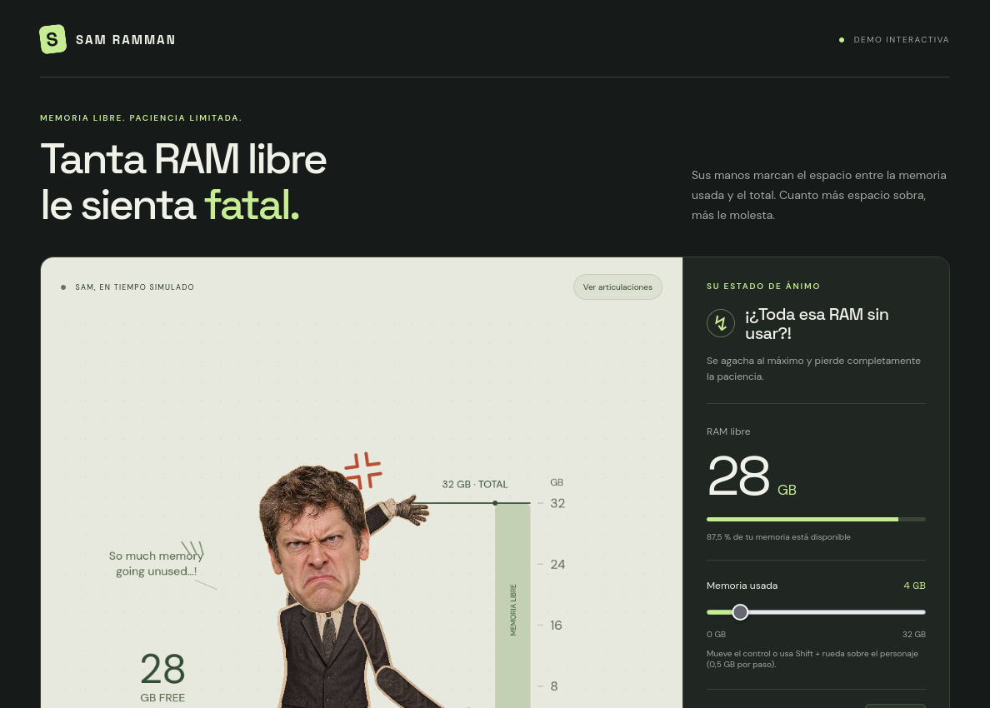
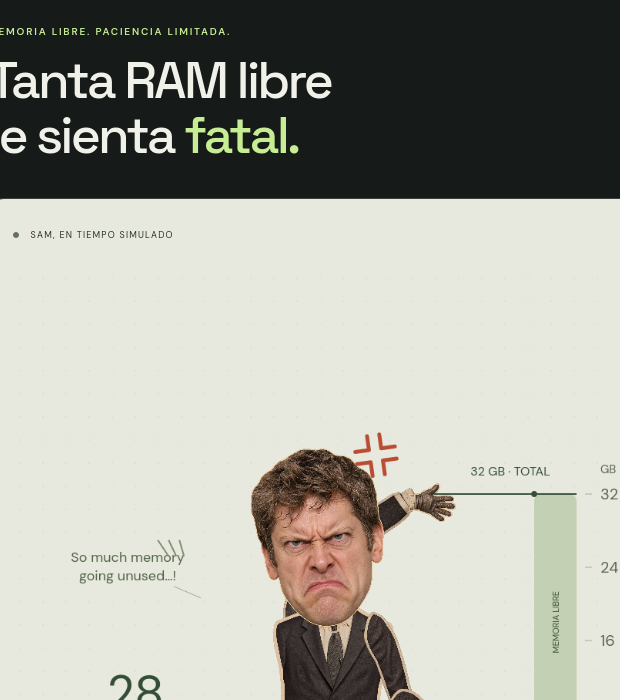

# Sam RAMman 🧠💥

Un personaje recortado interactivo y animado en **HTML5 Canvas** que reacciona al uso de la memoria RAM. Cuanta menos memoria RAM se utiliza, más se enfada y más se agacha.

👉 **[https://theanibalos.github.io/RAMman/](https://theanibalos.github.io/RAMman/)**



---

## 🚀 Inicio Rápido (Getting Started)

No necesitas instalar dependencias pesadas ni compilar nada.

### Opción 1: Medir la RAM real de tu computadora (En vivo)

Para que Sam lea la memoria real de tu sistema en tiempo real:

```sh
node server.js
```

Abre en tu navegador:
👉 **[http://localhost:3000](http://localhost:3000)**

Sam se conectará automáticamente y reflejará segundo a segundo el estado real de tu memoria.

---

### Opción 2: Modo simulador manual (Sin servidor)

Simplemente abre el archivo **`index.html`** directamente con doble clic en tu navegador favorito:

- Arrastra el control de **Memoria usada** para ver a Sam reaccionar.
- Pulsa **«Animar uso de RAM»** para una demostración automática en bucle.
- Pulsa **«Ver articulaciones»** para ver el esqueleto y la cinemática inversa.



---

## ⚙️ Personalización

### Cambiar el tamaño de la cabeza
En el archivo `ramman.js` (alrededor de la línea 141) puedes ajustar la variable:

```javascript
const headScale = 3; // 1 = tamaño original, 2 = doble, 3 = triple (cabezón)
```

---

## 📄 Licencia y Uso

**¡Úsalo para lo que quieras!**

Este proyecto es de código abierto y completamente libre. Puedes usarlo, modificarlo, integrarlo en tus propios proyectos, streams, overlays, widgets de escritorio o donde te sea útil.
